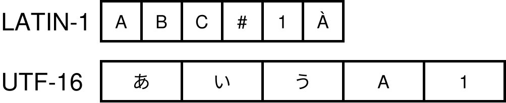
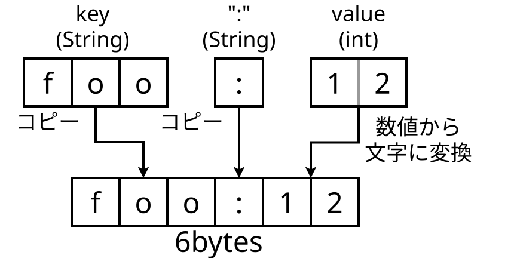
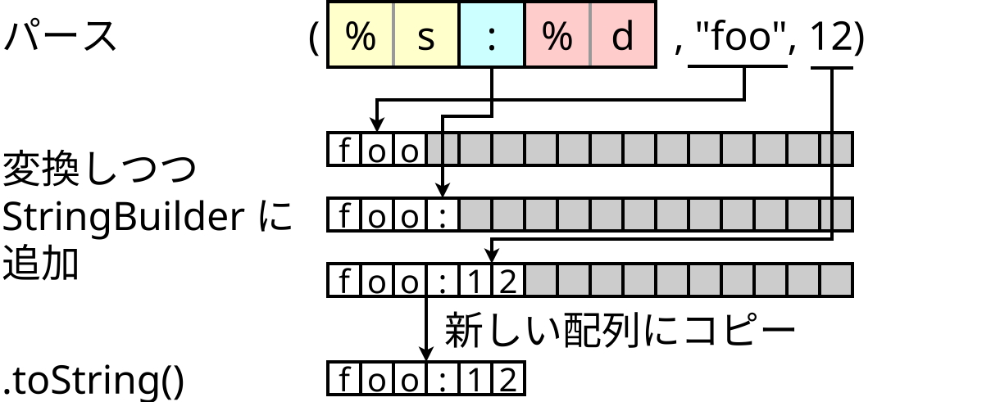

<!-- _class: lead -->

# String クラスの罠を理解して、
# 最高のパフォーマンスを
# 引き出そう！

 @YujiSoftware

---

# 目次

- 前置き
- 文字列の作り方による違い
  - \+ 演算子による文字列結合の場合
  - StringBuilder クラスを使った場合
  - String.format メソッドを使った場合


<div class="info">
本日のセッション資料 <br>
https://yuji.software/string-trap に置いてあります。
</div>

---

# 注意事項

- このセッションでは「速くなる書き方」と「遅くなる書き方」について解説します。

<hr>

- 遅い = 悪い **ではない**
- 実行頻度の低いコードは遅くても困らない
  - 例：ユニットテスト、初期化処理
  - これらは、遅くなる書き方でも 1ms も変わらない
- **一律に速くなる書き方を強制しないこと！**

---

# パフォーマンスの感覚

```java
for (int i = 0; i < 10000; i++) {
  for (int j = 0; j < 10000; j++) {
    // 処理
  } 
}
```
- 1万回の二重ループ
  - ループ内の実行回数は **1億回**
- ループ1回が 100ns 遅くなると、**全体では 10秒遅くなる**

<div class="info">
実行速度と計算回数の意識が大事
</div>

---

# 大事なポイント

- 内部の実装を把握する
  - **どういう仕組みだから**実行速度に差が生じているのかを理解することが大事
    - そのほうが応用が効く

---

# 文字列の作り方による違い

- \+ 演算子による文字列結合の場合
- StringBuilder クラスを使った場合
- String.format メソッドを使った場合

どれが**速い？遅い？**
遅いというのは、どれぐらい？

---

# 前提：文字列(String)の構造

- 特徴
  - 不変クラス
    - 文字列の変更は作り直し
- 主な中身
  - byte 配列
  - エンコーディング識別子

---

# 前提：文字列(String) の構造

- LATIN1 の文字**のみ**
  - LATIN1（1文字1バイト）で扱う
- LATIN1 以外の文字を含む 
  - UTF-16（1コード単位につき2バイト）で扱う



---

# \+ 演算子による文字列結合

- メリット
  - 書きやすい
- **一度に**文字列を結合するなら、これがベスト

```java
public String example(String key, int value) {
  return key + ":" + value;
}
```

これはどう動く？

---

# \+ 演算子による文字列結合の実装

1. 全体の長さを計算
    - エンコーディング<span class="supplement">（LATIN1 or UTF-16）</span>を確認
2. ちょうど収まる長さの byte 配列を作成
3. 各要素を文字列として表現し、必要な領域にコピーする

→ **無駄なく配列に文字を詰め込むようになっている**

<div class="info">
Java 9 以降の OpenJDK コンパイラの場合<br>
（Java 8 までは、StringBuilder に変換される）
</div>

---

# \+ 演算子による文字列結合の実装

- key = "foo", value = 12 の場合



---

# \+ 演算子の罠

- 分割すると、ちょっと遅くなる
  - 横に長くなってくると、文を分けたくなるが…

```java
String row = id + "," + name + "," + age + "," + address + …
```
↓
```java
String row = id + ",";
row += name + ",";
row += age + ",";
…
```
---

# 分割した際の動き


<div class="warn">
+= で結合すると、その度にコピーが発生してしまう
</div>

---

# 参考：どのぐらい差になるのか

- 自宅PCで、10個の変数を , 区切りで結合する処理を計測
  - 一度にまとめた場合： 49.839 (±0.160) ns/op
  - 一つずつ分けた場合： 88.198 (±0.321) ns/op

→ 分割すると、実行時間が **1.77倍** に伸びた

<div class="info">
環境による差異もあるので、あくまで参考程度
</div>

---

# StringBuilder クラスを使う

- 文字列を編集するためのクラス
  - 内部でどういう動きになっているのか？
  - \+ 演算子と比べて、どのぐらい性能がいいのか？

```java
public String example(String key, int value) {
  var sb = new StringBuilder();
  sb.append(key).append(":").append(value);

  return sb.toString();
}
```

---

# StringBuilder 文字列結合の動き

1. new StringBuilder()
    - 16文字分の容量のバッファを作成
2. .append(...)
    - バッファに追加
3. .toString()
    - バッファを元に文字列を作成

---

# StringBuilder 文字列結合の動き


---

# バッファが足りないとき

1. **約2倍**の容量に拡張する（正確には2倍＋2）
2. 中身をコピー
3. 新しい配列に文字を格納


---

# String の \+ 演算子との使い分け

- 一度に結合**できる**なら \+ 演算子を使う
- 一度に結合**できない**なら、基本的に StringBuilder を使う
  - ループで処理する場合など

どのぐらいの差があるのか？
（\+ 演算子もだいぶ速くなったけど…？）

---

# 参考：String vs StringBuilder

- 自宅PCで、8列のデータをカンマ区切りで結合するサンプルコードを計測（ns/op）

|行数|100|1,000|10,000|100,000|
|:--|--:|--:|--:|--:|
|String|26,403|2,406,795|315,674,831|36,596,801,877|
|Builder|6,453|65,769|700,336|8,275,654|
|比率|4|37|451|4,422|

<div class="warn">
String の + 演算子結合の連続は、急激に遅くなる
</div>

---

# StringBuilder の罠

- **初期のバッファサイズが小さい**（16文字分）
- 予測でいいので、全体のサイズを指定する
  - コピーが減るので、少し速くなる
  - 特に、文字列が長くなる場合は効果がある

```java
var sb = new StringBuilder(rows.length * 128);
```

---

# String.format / String#formatted

- メリット
  - 柔軟なフォーマットの指定が可能
  - できあがる文字列がわかりやすい
- String.formatted とは、書き方が違うだけで処理は同じ

```java
public String example(String key, int value) {
  return String.format("%s: %d", key, value);
  -- or -- 
  return "%s: %d".formatted(key, value);
}
```

---

# 実装

- Formatter クラスに移譲している
```java
return new Formatter().format(format, args).toString();
```

1. new Formtter(): 
    - 内部で StringBuilder を作成
2. format(format, args)
    - 引数の format をパース
    - 変換しつつ StringBuilder に追加
4. toString()

---

# 実装



---

# String.format の罠

- \+ 演算子や StringBuilder に比べて、**遅い**
  - パース処理や汎用的な変換処理による影響
- ただし、**新しいバージョンではかなり改善されている**

→ バージョンによって、使うかどうかの判断が分かれる

---

# 参考：バージョンごとの速度差

- String.format("%s: %d", key, value); の実行時間を測定


---

# 改善要因

- Java 16 まで、**パースに正規表現を使っているので遅かった**
- Java 17 で、単純なフォーマット（例：%d や %s）ならば
正規表現を使わない実装になった
- Java 19, 21 で細かい改善が行われた
- Java 23 で、複雑なフォーマット（例：%05d や %.2f）でも正規表現を使わない実装になった

→ 単純な結合だけなら、依然として \+ 演算子のほうが良い
→ フォーマット指定が必要なら、使うのはアリ

<!--
- [\[JDK-8263038\] Optimize String.format for simple specifiers](https://bugs.openjdk.org/browse/JDK-8263038)
- [\[JDK-8278642\] Refactor java.util.Formatter](https://bugs.openjdk.org/browse/JDK-8278642)
- [\[JDK-8335252\] Reduce size of j.u.Formatter.Conversion#isValid](https://bugs.openjdk.org/browse/JDK-8335252)
[\[JDK-8316704\] Regex-free parsing of Formatter and FormatProcessor specifiers - Java Bug System](https://bugs.openjdk.org/browse/JDK-8316704)
-->

---

# まとめ


---

<!-- _class: lead -->

# String クラスの罠を理解して、
# 最高のパフォーマンスを
# 引き出そう！

 @YujiSoftware

---

# 参考：ベンチマーク環境

- AMD Ryzen™ 7 5700X（8コア16スレッド）
- Ubuntu 26.04
- OpenJDK 25.0.5 (LTS)
- Java Microbenchmark Harness 1.37
  - Warmup: 1秒×5回
  - Measurement	1秒×5回
  - Fork: 2
- Code: https://github.com/YujiSoftware/string-trap/tree/main/benchmark
